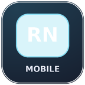
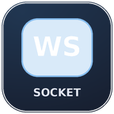
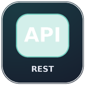
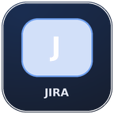
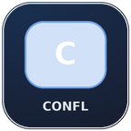
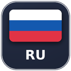
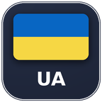
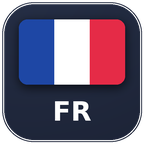
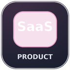
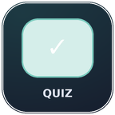

# Hey, I'm Anastasiia 👋

**Web Developer** · Frontend & Backend · Based in France 🇫🇷

I build modern web applications with a focus on clean architecture, user experience, and performance.

## 💻 Tech Stack

**Frontend**

  
  

**Backend & APIs**

  
  
  

**Databases & ORM**

  

**Tools**

  
  
  

## 🌍 Languages

  
  
  
  

## ✨ What I Build

  
  
  

Web apps · SaaS products · Interactive self-assessment systems

## 📫 Contact

  
  

